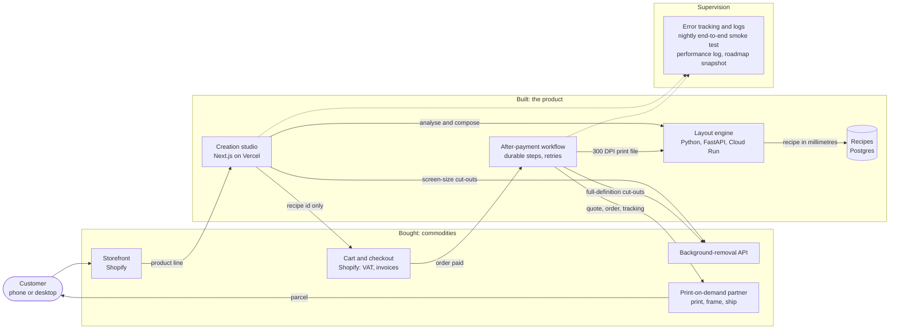

# David Carelli

**Operations & Product Builder · Entrepreneur · Data & AI** — based in Arcachon (Bordeaux) and Paris

I build products and run them. Background: large-scale digital services at La Poste (*L'Identité Numérique*, the La Poste digital identity, and *Compte La Poste*, the customer account), then took over, ran and sold a real estate agency, then a Data Science & AI certification (Le Wagon, RNCP level 6). Today I build with AI coding agents.

---

## melipelo — case study

> **In 30 seconds**
> - A consumer product I designed, built and operate alone, from brand naming (August 2026) to a production chain running end to end (November 2026).
> - Built *agentic-first*: specs, tickets and reviews are mine; most of the code is written by AI coding agents, including a scheduled agent that codes overnight.
> - Supervised from the start: error tracking, a nightly end-to-end test of the whole order chain, a performance log, and a written rollback for every production change.
> - About 370 merged pull requests and 300 tickets in 11 weeks.

### What it is, and for whom

melipelo turns the photos on your phone into a **pêle-mêle**: a dense, overlapping collage of people *cut out* from their photos (like iPhone stickers), printed and framed, delivered to your door. You drop 30 to 100+ photos, the studio cuts out every person, composes the collage automatically and lets you pick, adjust and order.

It is mostly a **gift**: the core customer is the person who organises family presents (birthdays, anniversaries, a new home). The product promise is "a hundred memories in one frame, without scissors or glue". It opens in France for the 2026 holidays, and in the rest of Europe after that.

<!--
SCREENSHOT 1. Add the image to assets/ and uncomment.

  
   <em>The studio, composition screen: dozens of photos cut out and composed automatically. The customer can shuffle (each layout is a seed), adjust a cut-out, then personalise borders, shadows and background without the layout ever being recomputed.</em>

-->

### Architecture

The guiding principle: **buy the commodity, build the value.** Everything from catalogue to invoice (storefront, checkout, EU VAT, invoices, transactional e-mails) is bought. Everything from photo upload to the validated print is the product, so it is built.

- **Front:** the Shopify storefront (custom theme sections) is only the door. Each product page sends the customer to the studio with a single parameter, the product line.
- **Creation studio:** upload (with a QR-code relay from phone to desktop), cut-outs, preview, adjustments, personalisation. The preview shows exactly what will be printed, and nothing else.
- **Layout engine:** an API-first Python service that knows nothing about Shopify, customers or sessions. It receives images and parameters and returns a *recipe*. It works in two steps: *analyse* (face detection, image definition) and *compose* (a deterministic, seeded placement algorithm). It also renders the 300 DPI print file.
- **Checkout:** only an opaque recipe id and a thumbnail link travel through the cart, never an image.
- **Print on demand:** after payment, a durable workflow makes the full-definition cut-outs, renders the print file, holds briefly before production, checks the quote, places the order, follows the parcel and marks the order shipped. Each step retries on its own and alerts if it finally fails.
- **Supervision:** see below.

### Stack

| Layer | Choices |
|---|---|
| Storefront and checkout | Shopify (customised theme, native VAT invoices) |
| Creation studio | Next.js 16, React 19, TypeScript (strict), Vercel |
| After-payment chain | Vercel Workflow: durable, step-level retries, replayable runs |
| Layout engine | Python 3.12, FastAPI, Pydantic, NumPy, OpenCV (YuNet face detection), Pillow (with HEIF), Docker, Google Cloud Run |
| Data | Postgres (recipes and compositions), Google Cloud Storage. All in the EU. |
| Design system | A separate repo of brand tokens, shared by the studio and the theme |
| Quality and ops | GitHub Actions (ruff, pytest, tsc, node tests, Next build), Sentry, Cloud Logging, nightly smoke test |
| Building | Claude Code (coding agents), GitHub Issues and Projects |

### How I build: agentic-first

I am the product owner, the architect and the reviewer. AI agents write most of the code. What makes this work is the method, not the tool.

1. **The project's memory lives in the repo, not in a chat.** One file describes the product, the architecture, the invariants that must never be broken, the conventions and the vocabulary. Every agent session starts by reading it. Every architecture decision is written into it the same day, otherwise the next session would not know about it.
2. **Specs come from workshops.** I hold short working sessions on one question (composition rules, pricing, the design of a screen) and turn them into written decisions. Those become design docs (composition strategy, a recipe contract with exported JSON Schemas) and validated screen mock-ups, which are the spec for the front end.
3. **Tickets carry the roadmap.** Every feature, fix or ops task is a GitHub issue (`EVO-xxx` for product, `OPS-xxx` for accounts, tax, domains and production), in one of four release milestones, with a criticality: *must-have* (no launch without it), *opportunity*, *comfort*. Decisions that wait for me are issues too: open means "waiting for David", closed with a comment means "settled, not reopened".
4. **One session = one branch = one pull request.** A session opens with a ritual: the agent reads the memory, yesterday's journal and today's plan, then proposes a branch, three to six short steps and an acceptance criterion, and waits for my go-ahead. It closes with another ritual: state updated, issues closed or created, a daily journal entry, a commit.
5. **I review every diff.** Short batches, one feature per commit, explained in plain words, and a pull request even when working solo. CI must be green before anything merges.
6. **A night shift.** A scheduled agent codes up to three independent front-end batches overnight, only from issues I have tagged and whose mock-up I have validated. It opens draft pull requests (about 400 lines at most) and never merges. I review them in the morning. Three pending night PRs is my review capacity, so it stops there.
7. **Deployment needs my go-ahead.** `main` deploys to a staging studio automatically. Production only changes through a release pull request that I merge myself, with its rollback written and rehearsed beforehand. New engine versions are deployed with no traffic and tested before they receive any.

A second assistant handles steering: the evening close writes tomorrow's plan, a morning brief reads it back, and a nightly "lookout" agent reads the roadmap snapshot and flags what threatens the launch.

### Supervision and dashboards from day one

- **Error tracking** was opened the same day as the code repository. Every failed step of the after-payment chain raises an alert with the order number, a short support code for the creation, the step and the error type. Never customer data, never the content of an error. A runbook says what to do for each case.
- **A nightly end-to-end smoke test** behaves like a customer on the staging studio: upload, cut-outs, composition, personalisation, then a signed "order paid" webhook. It checks the resulting print order, its references and the pixels of the print files. It runs green in about two and a half minutes.
- **Performance under management.** Standard scenarios (the same real family photos every time) and a measurement log with 100+ entries. The budget is 90 seconds from choosing the photos to the preview, and every change to the chain states its effect. For example, payment to print order takes 1 min 41 s for a 30-photo XL.
- **Nightly snapshots** of the roadmap board and of the public sites (status, visible text, dead links), read by the lookout agent.
- **A progress dashboard**: countdown to launch, a burn-up of the launch milestone, and completion of the technical skeleton, the commercial harness and readiness to take payments. It is updated at every evening close.
- **Next:** a commercial and technical dashboard (traffic, studio usage, revenue per product line, cut-out and layout performance) on BigQuery and Looker Studio.

<!--
SCREENSHOT 2. Add the image to assets/ and uncomment.

  
   <em>The progress dashboard: countdown to launch, burn-up of the launch milestone, and the gauges I steered the build with. Updated every evening by the closing routine.</em>

-->

### How the engine works 

**A deterministic engine, with AI as an adviser.** Layout is a seeded geometric algorithm: same seed, same parameters, same result, every time. That makes it testable, reproducible for printing and explainable to a customer. The product rules are encoded as hard constraints. For example, the eyes-nose-mouth core of a face is never covered or cut, and no cut-out is ever printed beyond what its pixels allow. AI is planned at three precise moments (annotating photos, proposing a composition plan, ranking candidate layouts), but the millimetre placement and the hard rules stay with the algorithm.

---

## Data & AI projects

From the Le Wagon Data Science & AI programme:

- [**data-classify-electrocardiograms**](https://github.com/dvdcrl/data-classify-electrocardiograms): deep learning classification of ECG signals (recurrent networks on heartbeat sequences, 5 classes).
- [**data-first-transformer**](https://github.com/dvdcrl/data-first-transformer): first steps with Hugging Face transformers (pipelines for NLP tasks).
- [**data-calling-llm-apis**](https://github.com/dvdcrl/data-calling-llm-apis): calling LLM APIs (Gemini) directly and through LangChain.
- [**taxifare-website**](https://github.com/dvdcrl/taxifare-website): end-to-end ML project, from model to a deployed web app (a Streamlit front end calling a fare-prediction API on Cloud Run).

---

## Contact

- LinkedIn: [linkedin.com/in/dcarelli](https://www.linkedin.com/in/dcarelli)
<!-- Uncomment once the shop is open to the public:
- melipelo: [melipelo.com](https://melipelo.com)
-->
